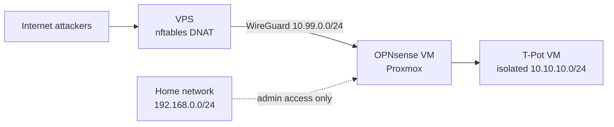

# T-Pot Honeypot in an Isolated Homelab
 
A multi-honeypot ([T-Pot](https://github.com/telekom-security/tpotce)) deployed in an isolated network segment behind an OPNsense firewall, exposed to the internet through a WireGuard tunnel from a VPS. The goal: collect real attack data safely, and document the network design, the problems I hit and what the data shows.
 
**Data period:** `[08.11.2026 - DD.MM.2026]` (update in progress)  
**Stack:** Proxmox, OPNsense, WireGuard, T-Pot 24.04, Elasticsearch/Kibana, nftables, VPS (Hetzner)

---

## 1. Goals
- Run a honeypot without putting my home network at risk.
- Practice network segmentation and firewall rule design.
- Collect and analyse real attack traffic, then map what I observed.

## 2. Architecture

| Zone | Network | Purpose |
|---|---|---|
| Home network | `192.168.0.0/24` | Sits on the WAN side of OPNsense. Reaches T-Pot only for administration (WebUI, SSH). |
| Honeypot segment | `10.10.10.0/24` | T-Pot VM, no access to home network or firewall management. |
| WireGuard tunnel | `10.99.0.0/24` | Carries attack traffic from the VPS and outbound traffic back. |
| VPS | public IPv4 | Receives attacks, forwards them through the tunnel. No logs or malware stored on it. |

**Design constraint:** Due to a lack of access to the ISP router, I decided to use OPNsense as a firewall and an intermediary gateway between the VPS and the T-Pot instance. The VPS serves primarily to provide a public IP address and a tunnel to the honeypot. This solution allows me to hide my home network behind the firewall and bypass the restrictions imposed by the ISP router.

## 3. Security controls
**OPNsense, evaluated top to bottom:**
